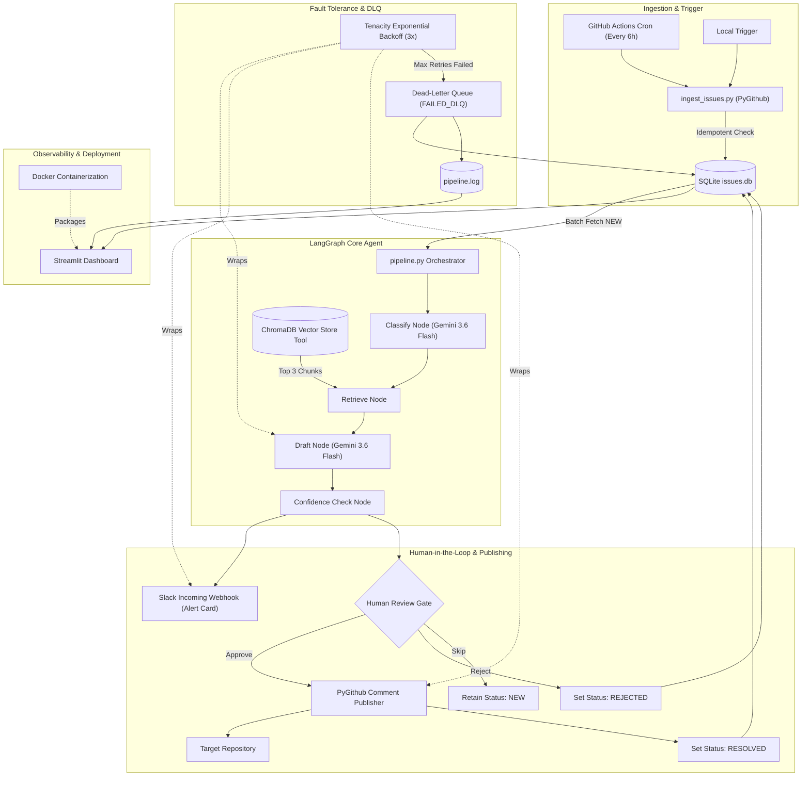

# 🤖 Agentic GitHub Issue Response Pipeline

An event-driven, fault-tolerant backend automation pipeline built with **LangGraph**, **Google Gemini**, **ChromaDB**, **PyGithub**, and **Slack**. The system ingests incoming repository issues, routes them through a stateful multi-step agent for classification and vector context retrieval, enforces a Human-in-the-Loop (HITL) approval gate via Slack, and auto-publishes verified technical responses back to GitHub.

---

## 🏗️ System Architecture & Workflow

## MCP Integration: Decoupled Retrieval Architecture

Documentation retrieval is decoupled from the agent runtime and served via an independent Model Context Protocol (MCP) server (`docs-retriever-mcp`) communicating over `stdio`.

### Architecture Comparison
* **Previous:** `[LangGraph Agent] ──> Direct Import ──> ChromaDB (In-Process)`
* **Current:** `[LangGraph Agent] ──> retriever.py (stdio client) ──> [docs-retriever-mcp] ──> ChromaDB`

### Operational Benefits
* **Lightweight Agent Footprint:** Eliminates client-side dependencies on `chromadb` and embedding frameworks in the agent environment.
* **Reusable Tooling:** The same retrieval engine serves this triage agent and external desktop assistants (such as Claude Desktop) simultaneously without modifying server logic.